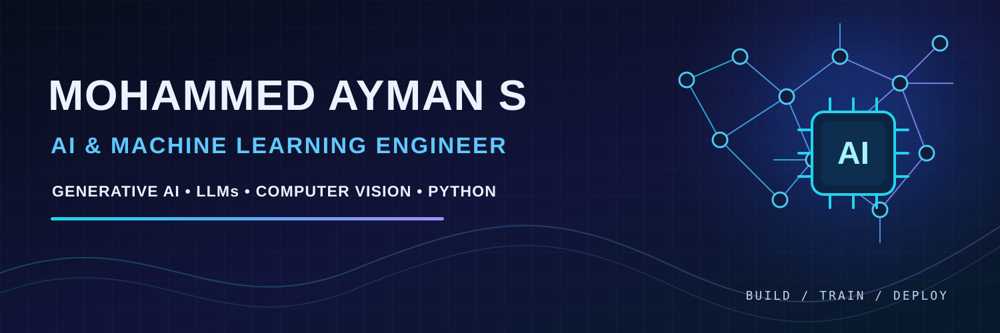

<!--
  Profile README — Mohammed Ayman S
  Keep project claims measurable and tied to working code or documented tests.
-->

# Mohammed Ayman S

### AI & Machine Learning Engineering Student | Generative AI Application Developer

Building practical AI-powered applications with Python, LLM APIs, computer vision, and modern web technologies.

  
  
  

---

## About

I am a Computer Science Engineering student specializing in **Artificial Intelligence and Machine Learning**, based in Chennai, India. I enjoy turning AI capabilities into useful software products—from educational tools powered by language models to image-generation applications.

My current focus is on:

- Building applications with **LLM APIs and Generative AI**.
- Integrating pretrained AI models into usable web products.
- Developing backend services with **Python and Flask**.
- Creating reliable, responsive interfaces and deploying projects to the web.
- Improving my foundations in machine learning, software engineering, testing, and AI system design.

I am interested in **AI Engineer, Generative AI Developer, and Junior Machine Learning Engineer** opportunities, as well as internships where I can learn from experienced engineering teams and contribute to real products.

## Featured projects

| Project | What it does | Technologies |
|---|---|---|
| [AYMAN STUDY AI](https://github.com/MohammedAyman07/ayman-study-ai) · [Live demo](https://ayman-study-ai.vercel.app) | AI-powered study platform with subject help, image-based question solving, quizzes, summaries, and formatted mathematical answers. | React, TypeScript, Vite, Tailwind CSS, LLM APIs, KaTeX |
| [AI Image Generator](https://github.com/MohammedAyman07/ai-image-generator) · [Live demo](https://ai-image-generator-three-iota.vercel.app/) | Web application that sends text prompts to the FLUX.1-schnell model through Hugging Face and returns generated images. Includes server-side token handling and basic rate limiting. | Python, Flask, Hugging Face, FLUX.1-schnell, Pillow, pytest |
| [PadiMachi Education Portal](https://github.com/MohammedAyman07/padimachi-education-portal) · [Live demo](https://padimachi-education-portal.vercel.app/) | Student-focused portal that organizes engineering and school study resources by subject, unit, and chapter. | HTML, CSS, JavaScript, Web Speech API |
| [AyWebSelling Marketplace](https://github.com/MohammedAyman07/aywebselling-marketplace) | Static digital-template marketplace with category filtering and a Node.js asset/build workflow. | HTML, CSS, JavaScript, Node.js |
| [DailyScroll Shopify Theme](https://github.com/MohammedAyman07/dailyscroll-shopify-theme) | Custom storefront/theme work exploring interactive web experiences and Shopify Liquid. | Shopify Liquid, JavaScript, CSS, Three.js |

## Technical skills

**AI & machine learning**
- Generative AI application development
- LLM API integration and prompt design
- Hugging Face model integration
- Image-generation workflows
- Exploring multimodal AI and computer vision concepts

**Programming & development**
- Python · JavaScript · TypeScript
- React · HTML5 · CSS3 · Tailwind CSS
- Flask · Node.js · REST API integration

**Tools & platforms**
- Git · GitHub · VS Code
- Vercel · Hugging Face
- MySQL fundamentals · pytest

> I keep this skills list focused on technologies I have used in projects or am actively developing. I am continuing to strengthen my machine-learning fundamentals and hands-on model-building experience.

## How I approach building AI products

1. **Start with a user problem.** Define what the application should help someone accomplish.
2. **Integrate models responsibly.** Use existing model APIs where appropriate, validate inputs, and handle provider errors.
3. **Protect credentials.** Keep private API keys on the server and configure them through environment variables.
4. **Build for real users.** Make the interface responsive, handle loading and failure states, and document local setup.
5. **Test and improve.** Add automated checks where practical and identify limitations before scaling.

## Currently learning

- Machine learning foundations and model evaluation
- Deep learning concepts and neural networks
- Python for data science
- LLM application patterns, retrieval, and tool integration
- Writing better tests and deploying maintainable services

## Let's connect

I welcome conversations with AI teams, software engineers, mentors, and recruiters. I am especially interested in opportunities where I can contribute to AI-powered products while growing as an engineer.

- **LinkedIn:** [Mohammed Ayman S](https://www.linkedin.com/in/mohammed-ayman-s-661396289)
- **Email:** [mohammedayman0107@gmail.com](mailto:mohammedayman0107@gmail.com)
- **GitHub:** [@MohammedAyman07](https://github.com/MohammedAyman07)

*Building, learning, testing, and improving—one project at a time.*

## Repository Licensing

Unless a repository contains a separate third-party or project-specific notice, my original portfolio project code is proprietary and all rights are reserved by Mohammed Ayman S. Public repositories are provided for viewing and technical evaluation only. Please check each repository's `LICENSE` file for its specific terms. Third-party libraries, assets, datasets, and other materials remain subject to their respective licences.
